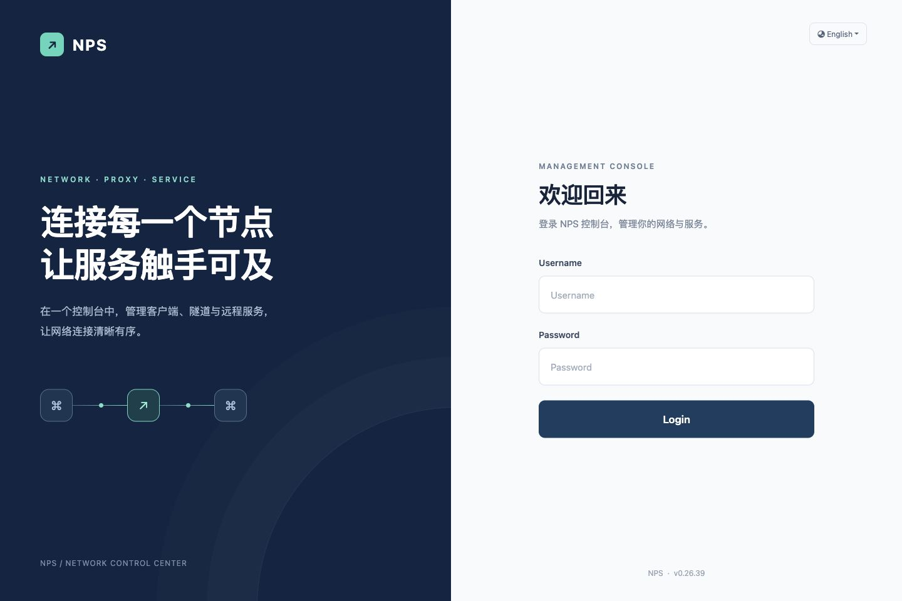
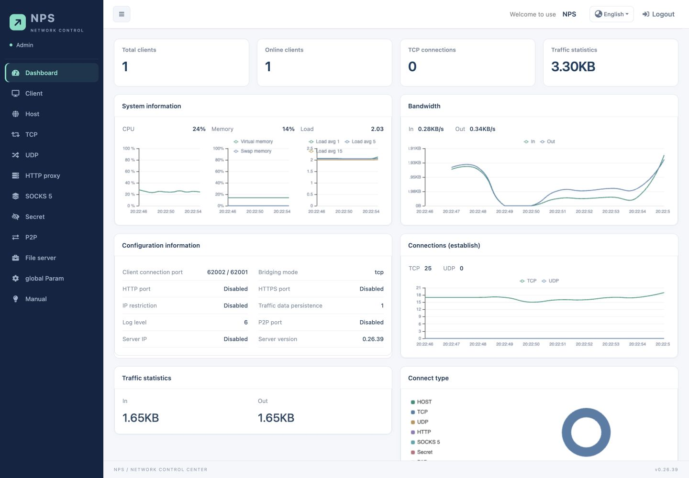

# NPS Lite

基于 [yisier/nps v0.26.39](https://github.com/yisier/nps/tree/v0.26.39) 的定制版，保留 NPS / NPC 功能和协议，重点改进凭据生成与管理界面。

## 本仓库的改动

- 新客户端默认 VKey 使用 `crypto/rand` 生成 16 个随机字节，编码为 32 位十六进制字符串（128 位随机强度）；已有客户端及手动指定的 Key 保持不变。
- 登录页采用深蓝与薄荷绿配色、左右双栏布局和 60px 高输入框；手机端自动上下排列。
- 管理端统一侧栏、表格、表单和弹窗样式；侧栏 216px、顶栏 60px，采用更紧凑的字号和间距。
- 仪表盘将 CPU、内存、负载收进一张资源卡片，使用独立坐标轴；TCP / UDP、上下行速率分别合并展示，累计流量改为数字摘要。
- 内存图统一使用百分比，修正上游的 MB 单位标注。
- 增加 VKey 格式、保存与重新加载兼容性测试。





## 本地编译

源码声明 Go 1.24.0，toolchain 为 Go 1.24.9；当前定制版使用 Go 1.26.1 编译验证。服务端和命令行客户端均可在本地交叉编译，无需在目标机器安装 Go。

```sh
go test ./lib/crypt ./lib/file
mkdir -p dist
CGO_ENABLED=0 GOOS=linux GOARCH=amd64 go build -trimpath -ldflags '-s -w' -o dist/nps ./cmd/nps/nps.go
CGO_ENABLED=0 GOOS=linux GOARCH=amd64 go build -trimpath -ldflags '-s -w' -o dist/npc ./cmd/npc/npc.go
```

Windows 命令行客户端：

```sh
CGO_ENABLED=0 GOOS=windows GOARCH=amd64 go build -trimpath -ldflags '-s -w' -o dist/npc.exe ./cmd/npc/npc.go
```

界面模板和静态文件通过 `go:embed` 嵌入程序。修改 `web/views/` 或 `web/static/` 后，需要重新编译并替换服务端二进制；仅复制 HTML / CSS 到服务器不会生效。

## 配置和启动

仓库只保存示例配置。先复制并编辑配置，再启动，避免使用程序自动生成的上游默认配置。

```sh
mkdir -p runtime/conf
cp conf/nps.conf.example runtime/conf/nps.conf
chmod 700 runtime runtime/conf
chmod 600 runtime/conf/nps.conf
```

必须替换 `web_password`、`auth_key` 和 16 个字符的 `auth_crypt_key` 占位值。例如使用 `openssl rand -hex 16` 生成管理员密码和 API Key，使用 `openssl rand -hex 8` 生成 16 字符的 `auth_crypt_key`。配置桥接端口、TLS 端口后，使用绝对目录启动：

```sh
./dist/nps -conf_path="$(pwd)/runtime"
```

`bridge_port` 是普通 TCP 连接端口，`tls_bridge_port` 是 TLS 连接端口。NPC 使用 TLS 时必须连接后者并添加 `-tls_enable=true`：

```sh
./dist/npc -server=YOUR_SERVER:TLS_PORT -vkey=YOUR_CLIENT_VKEY -tls_enable=true
```

示例管理页面仅监听 `127.0.0.1:8081`，通过 SSH 隧道访问：

```sh
ssh -N -L 18081:127.0.0.1:8081 USER@YOUR_SERVER
```

浏览器打开 `http://127.0.0.1:18081/`。

部分跨网环境中，Go 1.24 NPC 的默认混合 TLS 密钥交换可能出现握手超时。已部署环境通过 `GODEBUG=tlsmlkem=0` 恢复连接；这是可选兼容设置，仍使用 TLS，但关闭混合后量子密钥交换：

```sh
GODEBUG=tlsmlkem=0 ./dist/npc -server=YOUR_SERVER:TLS_PORT -vkey=YOUR_CLIENT_VKEY -tls_enable=true
```

## 升级已有实例

1. 在本地编译对应目标架构的程序。
2. 备份旧程序、整个 `conf/` 目录和启动 / 保活配置。
3. 上传至临时文件，核对 SHA-256；停止服务后原子替换二进制。
4. 使用原 `-conf_path` 重启，验证管理员登录、隧道和客户端重连。

升级时保留原配置和数据文件，不要用示例配置覆盖线上 `conf/`。32 位 VKey 生成器只影响新生成的 Key，不会迁移或重置已有 Key。

管理员凭据、客户端 Key、运行数据、日志、备份和编译产物不应提交到仓库。上游示例客户端 / 域名记录和自动发布工作流未纳入本仓库。

## 上游和许可证

保留上游源码及 GPL-3.0 许可证，见 [LICENSE](LICENSE)。上游介绍见 [README.upstream.md](README.upstream.md)，原中文说明见 [README_zh.md](README_zh.md)。
